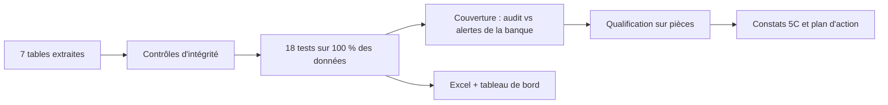

# Audit LBC/FT — UMOA

**Tester l'efficacité d'un dispositif de surveillance anti-blanchiment par l'analyse de données : un projet
d'auditeur interne, avec Python et des données 100 % fictives.**


> **Avertissement.** Projet pédagogique. La *Banque Fictive de l'Union (BFU)*, ses clients, ses opérations et
> la liste de sanctions utilisée sont **entièrement fictifs**. Les références réglementaires sont sourcées,
> mais ce dépôt ne constitue ni un avis juridique ni un outil validé pour un usage en production.

---

## La problématique

> **Le dispositif de surveillance LBC/FT d'une banque de l'UMOA détecte-t-il réellement les opérations à
> risque, et les alertes sont-elles analysées et déclarées dans les délais ?**

Un outil de surveillance produit des alertes ; on peut contrôler celles qui ont été traitées. Mais personne
ne voit les opérations **qui n'ont déclenché aucune alerte**. Or l'Instruction BCEAO n°001-03-2025 impose
d'auditer le dispositif LBC/FT **au moins une fois par an** (art. 11). Ce projet montre comment l'audit
interne peut le faire de façon exhaustive et reproductible :

1. **réexécuter** ses propres scénarios de détection sur 100 % des opérations ;
2. **mesurer la couverture** : les clients à risque identifiés ont-ils déclenché une alerte de la banque ?
3. **tester exhaustivement** le filtrage des sanctions, les déclarations, la file des alertes et les dossiers KYC ;
4. produire des **feuilles de travail Excel**, un **tableau de bord** et un **rapport au format 5C**.

## Ce que l'audit révèle sur la banque fictive

Sur 12 mois d'activité (1 200 clients, 97 992 opérations, 275 alertes) :

| | Résultat |
|---|---|
| Couverture du dispositif | **62 %** des 55 clients présentant des schémas à risque n'ont déclenché **aucune** alerte |
| Identifiants partagés | **13 clients** en 4 groupes (même téléphone ou même adresse, dont un foyer légitime) : **aucun** n'a déclenché d'alerte |
| Filtrage des sanctions | **3 correspondances fortes** avec la liste (fictive) non signalées par l'outil (accents, ordre des noms) |
| Pays à risque | Liste de l'outil figée depuis juillet 2024 : **11 pays** listés par le GAFI absents, **5 pays** retirés toujours présents (54 alertes inutiles) |
| Déclarations d'espèces (≥ 15 M FCFA) | **6 DTE** manquantes sur 55, dont 4 dans une seule agence |
| Traitement des alertes | **30 alertes** en souffrance (16 de plus de 180 jours) ; 36 clôtures « en masse » |

**Opinion proposée : Insuffisant** — 8 constats, dont 2 critiques. Rapport complet :
[`docs/07_rapport_de_mission.md`](docs/07_rapport_de_mission.md).


<table>
<tr>
<td></td>
<td></td>
</tr>
</table>

## Démarche



| Bloc | Tests | Question d'audit |
|---|---|---|
| Surveillance des opérations | **OPE-01** fractionnement des espèces · **OPE-02** comptes de passage · **OPE-03** flux incohérents avec le profil · **OPE-04** réactivation de comptes inactifs · **OPE-05** pays listés par le GAFI · **OPE-06** réseaux d'identifiants partagés | Quels clients présentent des schémas à risque ? |
| Efficacité du dispositif | **COU-01** couverture | L'outil de la banque les a-t-il vus ? |
| Filtrage | **FIL-01** correspondances approchées | Des clients figurent-ils sur la liste de sanctions ? |
| Déclarations et alertes | **DEC-01** DTE · **ALE-01** arriéré · **ALE-02** clôtures · **ALE-03** délais des DS | Les obligations et les délais sont-ils respectés ? |
| Connaissance client | **KYC-01** à **KYC-06** : complétude, pièces, revues, PPE, bénéficiaires effectifs, classification | Les dossiers permettent-ils une surveillance pertinente ? |

Chaque test documente son objectif, ses références (loi uniforme LBC/FT/FP de 2023, Décision n°021/2023,
instructions BCEAO de mars 2025, listes du GAFI), ses paramètres et sa population :
[`docs/06_catalogue_des_tests.md`](docs/06_catalogue_des_tests.md).

**Tester les tests.** Comme les données sont synthétiques, on connaît la vérité terrain : chaque scénario
retrouve 100 % des cas injectés, avec une précision de 77 à 100 % — les situations légitimes signalées
(cession d'un terrain, foyer partageant une adresse…) rappellent que **toute exception se vérifie sur
pièces** ([`docs/08_evaluation_des_tests.md`](docs/08_evaluation_des_tests.md)).

## Démarrage rapide

Prérequis : Python 3.10 ou plus récent.

```bash
# 1. Récupérer le projet (git clone <URL du dépôt>, ou bouton « Code » > « Download ZIP »), puis :
cd audit-lbcft-umoa
python -m venv .venv
# Windows : .venv\Scripts\activate      macOS / Linux : source .venv/bin/activate
pip install -r requirements.txt

# 2. Lancer les 18 tests et produire les feuilles de travail Excel
python -m lbcft_audit auditer

# 3. Ouvrir le tableau de bord dans le navigateur
streamlit run app/tableau_de_bord.py
```

Autres commandes :

| Commande | Effet |
|---|---|
| `python -m lbcft_audit generer` | Régénère les données fictives (identiques à chaque fois : graine fixe) |
| `python -m lbcft_audit rapport` | Régénère le rapport de mission, la page d'évaluation et les graphiques |
| `python -m lbcft_audit evaluer` | Affiche le rappel et la précision de chaque scénario |
| `python -m lbcft_audit tout` | Enchaîne toutes les étapes |
| `pip install -r requirements-dev.txt && pytest` | Lance les tests automatisés |

Les seuils, listes et hypothèses se modifient dans [`config/parametres.yaml`](config/parametres.yaml) : chaque
seuil réglementaire y est sourcé, chaque hypothèse d'audit signalée.

## Livrables

| Livrable | Emplacement |
|---|---|
| Feuilles de travail (un onglet par test, méthodologie, intégrité, priorisation) | `outputs/resultats_audit_lbcft.xlsx` |
| Tableau de bord interactif (synthèse, tests, fiche client, constats) | `app/tableau_de_bord.py` |
| Rapport de mission au format 5C (généré) | `docs/07_rapport_de_mission.md` |
| Contexte, cadre réglementaire, méthodologie | `docs/01` à `docs/03` |
| Matrice risques / contrôles et programme de travail | `docs/04`, `docs/05` |

## Structure du dépôt

```text
audit-lbcft-umoa/
├── app/tableau_de_bord.py      # tableau de bord Streamlit
├── config/parametres.yaml      # seuils réglementaires, listes du GAFI, hypothèses d'audit
├── data/                       # données fictives + dictionnaire (data/README.md)
├── docs/                       # documentation, rapport généré, graphiques
├── lbcft_audit/                # le code : génération, intégrité, 18 tests, constats, exports
│   ├── generation.py           # banque fictive et typologies injectées
│   ├── tests_operations.py     # OPE-01 à OPE-06
│   ├── tests_kyc.py            # KYC-01 à KYC-06 et FIL-01
│   ├── tests_declarations.py   # DEC-01, ALE-01 à ALE-03
│   ├── moteur.py               # exécution, couverture (COU-01), priorisation
│   └── constats.py             # rédaction des constats 5C
├── outputs/                    # classeur Excel produit
└── tests/                      # tests automatisés (pytest)
```

## Et sur des données réelles ?

Le code est conçu pour être adapté, à quatre conditions :

1. l'exécuter **dans l'environnement sécurisé de la banque**, jamais sur un service en ligne ;
2. activer la **pseudonymisation** (`pseudonymisation.active: true`, sel fourni par la variable
   d'environnement `LBCFT_SEL`) et ne jamais déposer de données réelles dans un dépôt Git ;
3. aligner les paramètres sur le **texte national** et la **procédure interne**, et mettre à jour les
   listes du GAFI après chaque plénière ;
4. traiter chaque exception comme une anomalie à expliquer : **vérification sur pièces** avant tout constat,
   et transmission des cas potentiellement suspects à la conformité, seule habilitée à déclarer à la
   CENTIF — sans jamais alerter le client.

## Limites

- Les typologies injectées sont celles que les tests recherchent : le rappel de 100 % valide le code, pas
  l'efficacité sur des données réelles.
- Les seuils internes (délais, multiples de revenu, fenêtres) sont des hypothèses à calibrer.
- Certains risques ne se testent pas par les données (confidentialité des déclarations, formation,
  archivage) : ils figurent au programme de travail ([`docs/05_programme_de_travail.md`](docs/05_programme_de_travail.md)).

## Références principales

- Loi uniforme relative à la LBC/FT/FP dans les États membres de l'UMOA (2023) —
  [texte publié par la BCEAO](https://bceao.int/sites/default/files/2025-02/Loi-uniforme-LBCFTFP-Mars-2023-vf.pdf)
- Décision n°021 du 21/12/2023/CM/UMOA (montants seuils) ; Instructions BCEAO n°001, 002 et 003-03-2025 du
  18 mars 2025 — [page LBC/FT de la Commission Bancaire](https://cb-umoa.org/en/lbc-ft)
- Instructions BCEAO n°231/07/2024 et n°233/07/2024 (seuils espèces)
- GAFI, déclarations publiques du 19 juin 2026 — [fatf-gafi.org](https://www.fatf-gafi.org)
- IIA, Normes mondiales d'audit interne (2024, en vigueur depuis le 9 janvier 2025)

Détail et réserves : [`docs/02_cadre_reglementaire.md`](docs/02_cadre_reglementaire.md).

## English summary

A portfolio project by an internal auditor in the West African Monetary Union (WAMU/UMOA). It shows how
internal audit can independently test an AML/CFT transaction-monitoring system on 100 % of the data:
re-running detection scenarios (structuring, pass-through accounts, mule networks, dormant-account
reactivation, high-risk jurisdictions), measuring the bank's alert coverage, re-performing sanctions
screening with fuzzy matching, and testing KYC, alert handling and regulatory reporting. Everything runs
on a fully synthetic bank. Stack: Python, pandas, matplotlib, Streamlit, pytest.

## Licence

Code publié sous licence MIT. Conçu par **Mamad**, auditeur interne bancaire (zone UMOA). Les retours et
suggestions sont les bienvenus via les *issues* du dépôt.
