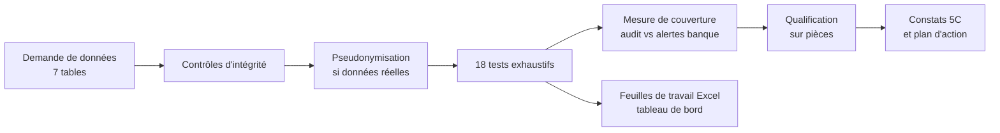

# 3. Méthodologie

La démarche suit les étapes d'une mission d'audit interne (Normes mondiales d'audit interne de l'IIA),
outillée par l'analyse de données.

## 3.1 Cadrage

- **Objectif** : évaluer l'efficacité du dispositif de surveillance LBC/FT (détection, filtrage,
  traitement des alertes, déclarations, connaissance client).
- **Période** : 1er juillet 2025 – 30 juin 2026 ; données arrêtées au 30 juin 2026.
- **Référentiel** : textes de l'UMOA (voir `02_cadre_reglementaire.md`) et procédures internes de la
  banque. Quand la procédure interne n'est pas connue, le projet retient une **hypothèse explicite**, signalée
  comme telle dans `config/parametres.yaml`.
- **Livrables** : matrice risques / contrôles, programme de travail, feuilles de travail, rapport de mission.

## 3.2 Demande de données

| Table | Contenu | Usage principal |
|---|---|---|
| `clients` | Identité, profil déclaré, classification, PPE, pièce, dernière revue KYC, dernier filtrage | KYC, profils de référence |
| `comptes` | Comptes, agence, date d'ouverture, dernier mouvement avant la période | Réactivations |
| `operations` | Toutes les opérations de la période (espèces, virements, transferts internationaux) | Scénarios OPE |
| `alertes` | Alertes de l'outil de surveillance et leur traitement | Couverture, ALE |
| `declarations_soupcon` | Registre des déclarations de soupçon | ALE-03 |
| `declarations_especes` | Registre des déclarations de transactions en espèces | DEC-01 |
| `liste_sanctions` | Liste utilisée pour le filtrage (fictive ici) | FIL-01 |

Format : CSV séparateur « ; », encodage UTF-8, dates ISO. Le dictionnaire est dans `data/README.md`.

## 3.3 Contrôles d'intégrité (préalable obligatoire)

Avant tout test : nombre de lignes, unicité et complétude des clés, période couverte, intégrité
référentielle (opérations → comptes → clients, alertes → opérations), montants positifs, et **totaux des
crédits et débits à rapprocher de la balance**. Sans ce rapprochement, les résultats sont provisoires.

## 3.4 Tests exhaustifs

Les 18 tests sont décrits dans `06_catalogue_des_tests.md`. Ils se répartissent en cinq blocs :

| Bloc | Tests | Question |
|---|---|---|
| Surveillance des opérations | OPE-01 à OPE-06 | Quels clients présentent des schémas à risque ? |
| Efficacité du dispositif | COU-01 | Ces clients ont-ils déclenché une alerte de la banque ? |
| Filtrage | FIL-01 | Des clients correspondent-ils à la liste de sanctions ? |
| Déclarations et alertes | DEC-01, ALE-01 à ALE-03 | Les obligations déclaratives et les délais sont-ils respectés ? |
| Connaissance client | KYC-01 à KYC-06 | Les dossiers sont-ils complets, à jour et cohérents ? |

Principes :

- **Exhaustivité** : 100 % de la population, pas d'échantillon.
- **Indépendance** : l'auditeur rejoue ses propres scénarios, sans utiliser ceux de la banque.
- **Traçabilité** : chaque test documente objectif, référence, paramètres, population et exceptions ;
  le code et les paramètres sont versionnés (Git), le jeu de données est reproductible (graine fixe).

## 3.5 Mesure de la couverture

Pour chaque client identifié par un scénario de l'audit (OPE-01 à OPE-06), on vérifie s'il a fait l'objet
d'au moins une alerte de l'outil de la banque sur la période, puis comment cette alerte a été traitée
(classement sans suite, analyse en cours, déclaration de soupçon). La mesure est volontairement
**prudente** : une alerte quelconque sur le client suffit à le considérer comme « vu » par la banque.

## 3.6 Qualification des exceptions

Une exception est une **anomalie à expliquer**, pas encore un constat (scepticisme professionnel) :

1. trier les exceptions par risque (score de priorisation, montants) ;
2. vérifier les pièces sur un échantillon (justificatifs, dossier KYC, rapport d'analyse de l'alerte) ;
3. qualifier : anomalie avérée, faux positif, explication valide ;
4. documenter la qualification dans la feuille de travail (colonnes « Conclusion », « Préparé par »,
   « Revu par »).

Le score de priorisation (`Priorisation` dans l'Excel) pondère les tests déclenchés pour **ordonner les
revues** ; il ne qualifie jamais un soupçon.

## 3.7 Soupçon de blanchiment : la conduite à tenir

L'auditeur qui identifie un cas potentiellement suspect :

- **n'alerte jamais le client** ni les personnes concernées (art. 63 de la loi uniforme : interdiction de
  divulgation) ;
- préserve les preuves (extractions datées, scripts, journaux) ;
- transmet les éléments au **responsable de la conformité**, selon la charte d'audit — seule la fonction
  habilitée déclare à la CENTIF ;
- reste factuel : il établit des faits, la qualification juridique relève d'autres acteurs.

## 3.8 Rédaction des constats (format 5C)

Chaque constat comporte : **Critère** (la règle), **Constat** (les faits chiffrés), **Cause** (présumée,
à confirmer en entretien), **Conséquence** (le risque), **Recommandation** (action vérifiable, responsable,
échéance). Notation : Critique, Majeur, Modéré, Faible. Aucun nom de personne dans le rapport.

## 3.9 Sur données réelles

1. Exécuter le projet **dans l'environnement sécurisé de la banque**, jamais sur un service en ligne.
2. Adapter `config/parametres.yaml` : texte national, procédure interne, listes du GAFI à jour.
3. Activer la pseudonymisation (`pseudonymisation.active: true`) et fournir le sel par la variable
   d'environnement `LBCFT_SEL`.
4. Ne jamais verser de données réelles dans un dépôt Git (`data/reelles/` est exclu par `.gitignore`).
5. Faire valider l'outil (revue du code, tests sur cas connus) avant d'en tirer des conclusions.
