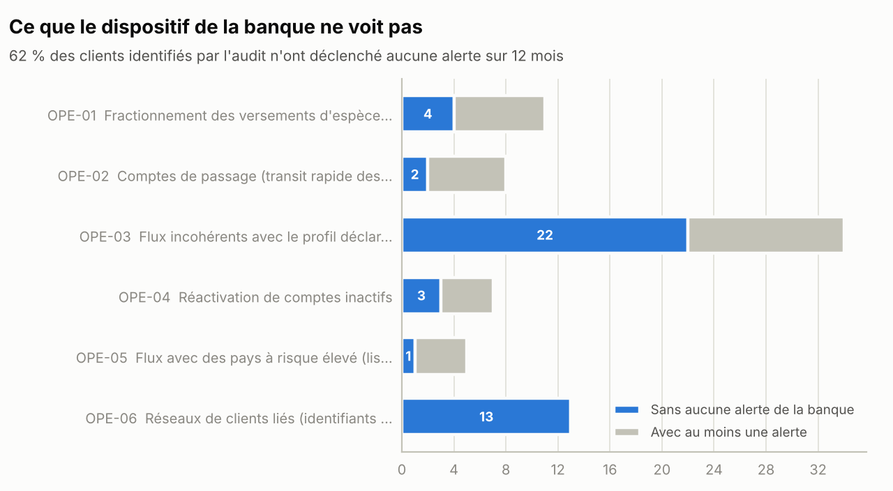
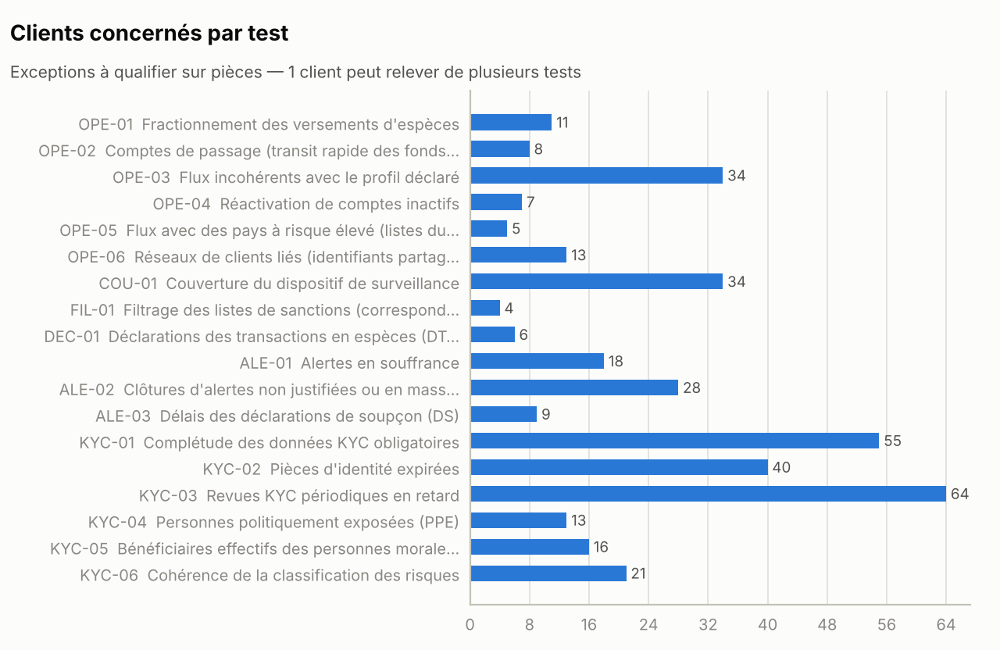
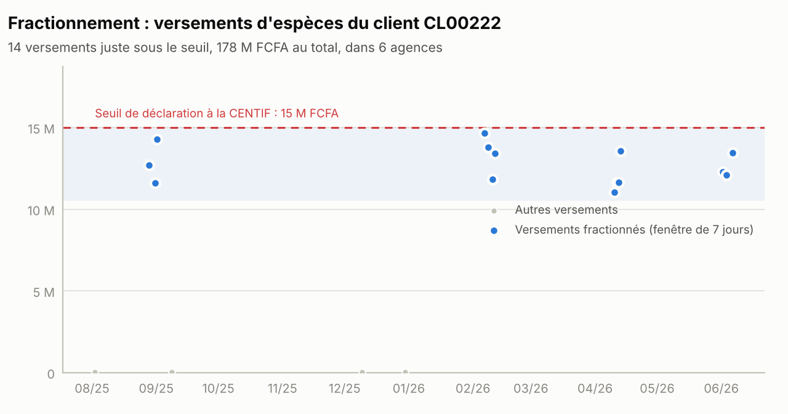
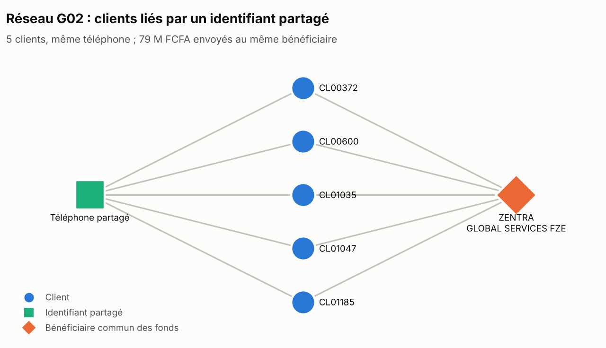
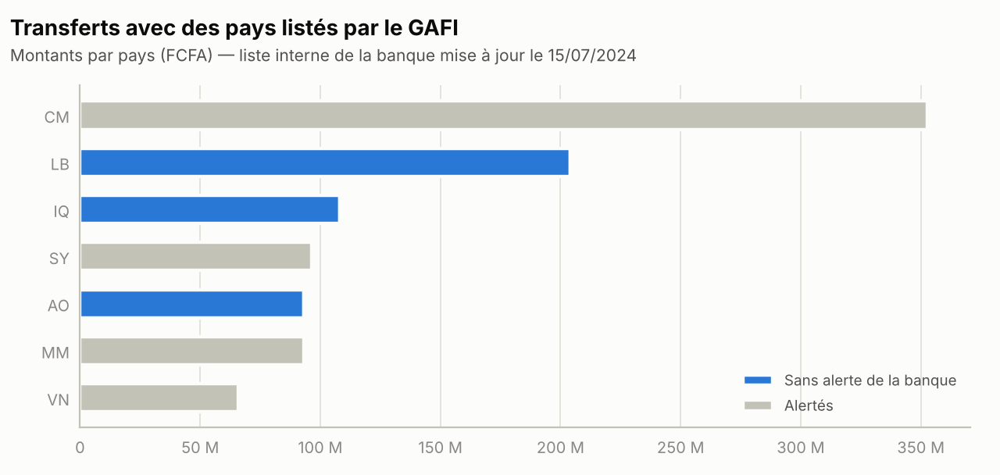
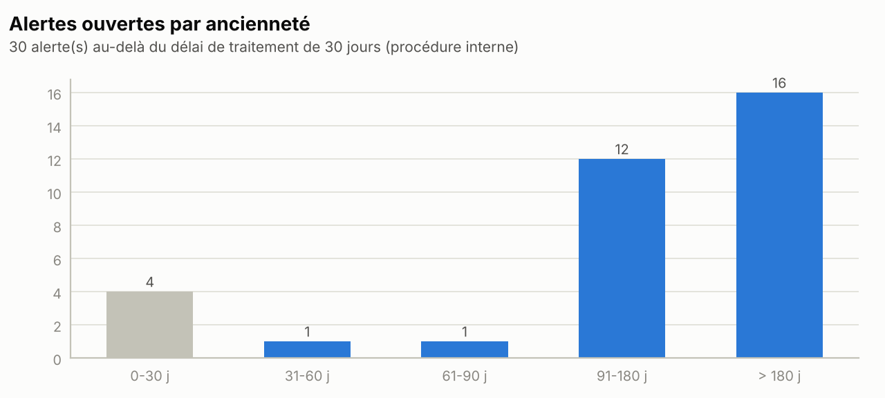
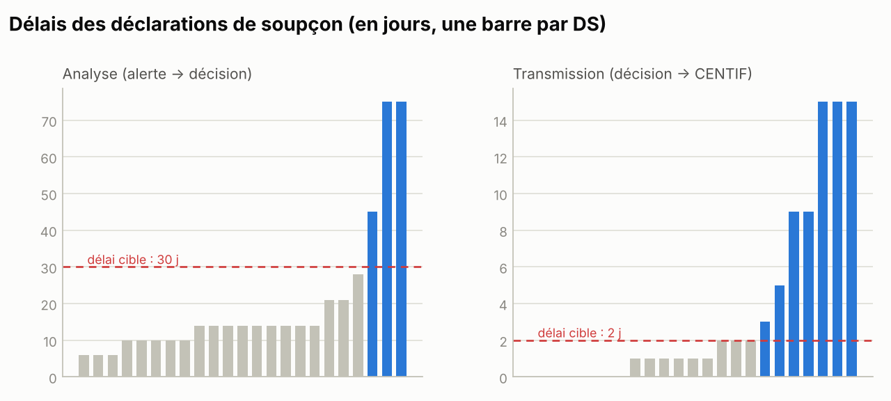
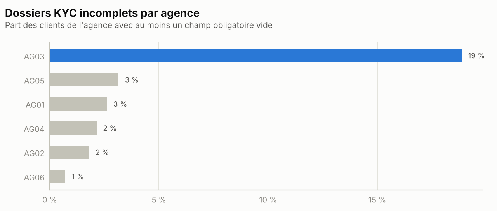

# Rapport de mission — Évaluation du dispositif LBC/FT

> **Projet de rapport généré automatiquement** par `python -m lbcft_audit rapport` à partir des données
> **100 % fictives** de la *Banque Fictive de l'Union (BFU)*. Les faits chiffrés sont calculés ; les causes sont présumées et
> doivent être confirmées en entretien ; l'opinion et les recommandations relèvent du jugement de
> l'auditeur. Confidentiel — usage interne (sur données réelles).

| | |
|---|---|
| **Entité auditée** | Banque Fictive de l'Union (BFU) — dispositif de lutte contre le blanchiment de capitaux et le financement du terrorisme |
| **Période testée** | du 01/07/2025 au 30/06/2026 (date d'arrêté : 30/06/2026) |
| **Populations** | 1 200 clients, 1 386 comptes, 97 992 opérations, 275 alertes, 23 déclarations de soupçon |
| **Approche** | 18 tests exhaustifs par analyse de données (100 % des populations), exceptions à qualifier sur pièces |
| **Date du projet** | 10/10/2026 |

## 1. Synthèse

**Opinion proposée : Insuffisant** — à valider par le responsable de l'audit interne.

L'audit a évalué la capacité du dispositif à détecter, analyser et déclarer les opérations à risque. Il
relève **8 constats** (2 critiques, 6 majeurs). Le fait marquant : **62 % des 55 clients présentant des schémas à risque n'ont déclenché aucune alerte** de l'outil de surveillance sur douze mois.

Constats clés :

- **C1 (Critique)** — Correspondances avec la liste de sanctions non détectées par le filtrage.
- **C2 (Critique)** — Schémas à risque non couverts par le dispositif de surveillance.
- **C3 (Majeur)** — Liste des pays à risque non mise à jour dans l'outil de surveillance.
- **C4 (Majeur)** — Déclarations de transactions en espèces (DTE) non transmises.
- **C5 (Majeur)** — Arriéré d'alertes et clôtures non justifiées.

## 2. Contexte, périmètre et approche

- **Pourquoi cette mission.** L'Instruction BCEAO n°001-03-2025 prévoit que le dispositif de contrôle LBC/FT
  soit audité au moins une fois par an, les conclusions étant soumises à l'organe délibérant (art. 11).
- **Périmètre.** Surveillance des opérations, obligations déclaratives (DS, DTE), traitement des alertes,
  connaissance client (KYC, PPE, bénéficiaires effectifs) et filtrage des sanctions.
- **Approche.** Contrôles d'intégrité des extractions, puis réexécution indépendante de 18 tests
  sur 100 % des populations (voir `docs/06_catalogue_des_tests.md`). Les paramètres réglementaires
  sont sourcés ; les hypothèses d'audit sont signalées dans `config/parametres.yaml`.
- **Limites.** Les exceptions ne sont pas des constats tant qu'elles n'ont pas été vérifiées sur pièces.
  L'audit ne qualifie pas le soupçon : les cas sont transmis à la conformité, seule habilitée à
  déclarer à la CENTIF. Les totaux d'opérations restent à rapprocher de la comptabilité.

## 3. Points forts relevés

- Les extractions sont intègres : aucune anomalie de clé, de période ni de cohérence comptes / clients (totaux restant à rapprocher de la comptabilité).
- Les versements d'espèces unitaires d'au moins 15 M FCFA sont alertés : 100 % des 21 cas.
- Les transferts avec les pays faisant l'objet d'un appel à action du GAFI sont alertés : 100 % des 4 cas.
- 89 % des DTE attendues figurent au registre des déclarations.

## 4. Constats détaillés (format 5C)

### C1 — Correspondances avec la liste de sanctions non détectées par le filtrage

**Notation : Critique** · Tests : FIL-01 · Responsable proposé : Responsable de la conformité ; DSI · Échéance proposée : Immédiate (< 1 mois)

| | |
|---|---|
| **Critère** | Le système d'information doit permettre le filtrage des clients et la prise en compte « sans délai » des mesures de sanctions financières ciblées (Instruction BCEAO n°001-03-2025, art. 6 ; recommandation 6 du GAFI). |
| **Constat** | Le rejeu du filtrage de 1 200 clients avec une comparaison approchée fait ressortir 4 correspondances : 3 fortes (nom et date de naissance identiques, ou raison sociale identique hors forme juridique) et 1 homonymie probable à lever. Aucune n'a été signalée par l'outil de la banque. Exemples : client CL00628 / entrée FICT-016 (score 1,00) ; client CL00053 / entrée FICT-015 (score 0,97) ; client CL00805 / entrée FICT-029 (score 1,00). |
| **Cause** | Cause présumée, à confirmer avec la DSI et l'éditeur : comparaison exacte des noms, sans normalisation des accents, de l'ordre des mots ni des formes juridiques. |
| **Conséquence** | Risque d'entrer ou de rester en relation, et d'exécuter des opérations, avec des personnes ou entités visées par des mesures de gel des avoirs : sanctions et atteinte grave à la réputation. |
| **Recommandation** | Traiter sans délai les 3 correspondances fortes selon la procédure de gel des avoirs et documenter la levée des homonymies ; paramétrer une recherche approchée (seuil calibré) ; tester le filtrage avec un jeu de cas de contrôle à chaque mise à jour de l'outil ou des listes. |
| **Réponse de l'audité** | *À recueillir lors de la réunion de clôture.* |

### C2 — Schémas à risque non couverts par le dispositif de surveillance

**Notation : Critique** · Tests : COU-01, OPE-01, OPE-02, OPE-03, OPE-04, OPE-06 · Responsable proposé : Responsable de la conformité ; Direction des risques ; DSI · Échéance proposée : Immédiate (< 1 mois)

| | |
|---|---|
| **Critère** | Le dispositif doit assurer le profilage des clients, le suivi des mouvements avec génération d'alertes et l'identification des opérations suspectes ; il est révisé au moins une fois par an (Instruction BCEAO n°001-03-2025, art. 6). Les opérations inhabituelles font l'objet d'un examen particulier (Loi uniforme LBC/FT/FP, art. 20 et 21). |
| **Constat** | Les scénarios rejoués par l'audit sur 100 % des 97 992 opérations identifient 55 clients présentant des schémas à risque. 34 d'entre eux (62 %) n'ont déclenché aucune alerte sur 12 mois (OPE-01 : 4 sur 11 sans alerte ; OPE-02 : 2 sur 8 sans alerte ; OPE-03 : 22 sur 34 sans alerte ; OPE-04 : 3 sur 7 sans alerte ; OPE-05 : 1 sur 5 sans alerte ; OPE-06 : 13 sur 13 sans alerte). 8 autres clients n'ont eu que des alertes classées sans suite. L'outil comporte 4 scénarios (ESP-01, PAY-01, PRO-01, TRF-01) et aucun scénario de fractionnement, de transit rapide, de réactivation de compte inactif ni d'identifiants partagés. |
| **Cause** | Cause présumée : scénarios fondés sur des seuils unitaires ; absence de revue annuelle documentée de leur pertinence et de leur couverture des typologies. |
| **Conséquence** | Opérations suspectes non détectées et non déclarées à la CENTIF (Loi uniforme, art. 60) ; exposition au blanchiment et aux sanctions de la Commission Bancaire. |
| **Recommandation** | Transmettre sans délai à la conformité la liste priorisée des 55 clients pour analyse et, le cas échéant, déclaration ; compléter l'outil par des scénarios couvrant ces typologies ; instaurer une revue annuelle de l'efficacité des scénarios (taux d'alertes pertinentes, tests de couverture). |
| **Réponse de l'audité** | *À recueillir lors de la réunion de clôture.* |

### C3 — Liste des pays à risque non mise à jour dans l'outil de surveillance

**Notation : Majeur** · Tests : OPE-05 · Responsable proposé : Responsable de la conformité · Échéance proposée : 3 mois

| | |
|---|---|
| **Critère** | Les relations et opérations avec les pays présentant un risque plus élevé font l'objet d'une vigilance renforcée (Loi uniforme LBC/FT/FP, art. 30), sur la base des déclarations publiques du GAFI (dernière en date : 19/06/2026). |
| **Constat** | La liste paramétrée (mise à jour le 15/07/2024) omet 11 pays listés par le GAFI (Angola, Bosnie-Herzégovine, Bolivie, Côte d'Ivoire, Irak, Koweït, Laos, Liban, Népal, Papouasie-Nouvelle-Guinée, Îles Vierges britanniques) et conserve 5 pays retirés des listes (Burkina Faso, Mozambique, Namibie, Nigeria, Afrique du Sud). Effets mesurés : 21 transferts (405 400 000 FCFA) avec Angola, Irak, Liban sans aucune alerte ; 54 alertes générées sur des pays retirés. |
| **Cause** | Cause présumée : pas de procédure de mise à jour de la liste après chaque plénière du GAFI. |
| **Conséquence** | Vigilance renforcée non appliquée à des flux à risque ; charge d'analyse consommée par des alertes devenues sans objet. |
| **Recommandation** | Mettre la liste à jour ; formaliser sa révision après chaque plénière du GAFI (février, juin, octobre) avec un contrôle de second niveau ; revoir a posteriori les transferts non alertés. |
| **Réponse de l'audité** | *À recueillir lors de la réunion de clôture.* |

### C4 — Déclarations de transactions en espèces (DTE) non transmises

**Notation : Majeur** · Tests : DEC-01 · Responsable proposé : Responsable de la conformité ; Direction du réseau d'agences · Échéance proposée : 3 mois

| | |
|---|---|
| **Critère** | Les transactions en espèces d'un montant au moins égal à 15 M FCFA, en une ou plusieurs opérations liées, sont déclarées à la CENTIF (Loi uniforme LBC/FT/FP, art. 72 ; Décision n°021 du 21/12/2023/CM/UMOA). |
| **Constat** | 55 DTE étaient attendues sur la période (cumul journalier par client et par sens). 6 sont absentes du registre (138 160 000 FCFA). L'agence AG05 concentre 4 omissions, soit 31 % de ses DTE attendues. |
| **Cause** | Cause présumée : identification manuelle des DTE en agence, sans contrôle de second niveau. |
| **Conséquence** | Manquement à une obligation déclarative ; sanctions de l'autorité de supervision. |
| **Recommandation** | Régulariser les déclarations manquantes ; automatiser la détection des DTE (y compris les opérations liées) ; contrôle mensuel d'exhaustivité par la conformité. |
| **Réponse de l'audité** | *À recueillir lors de la réunion de clôture.* |

### C5 — Arriéré d'alertes et clôtures non justifiées

**Notation : Majeur** · Tests : ALE-01, ALE-02 · Responsable proposé : Responsable de la conformité · Échéance proposée : 3 mois

| | |
|---|---|
| **Critère** | Les opérations inhabituelles sont examinées et l'examen est consigné dans un rapport écrit confidentiel, conservé dix ans (Loi uniforme LBC/FT/FP, art. 21 et 23) ; délai interne de traitement : 30 jours. |
| **Constat** | 34 alertes étaient ouvertes au 30/06/2026, dont 30 hors délai (16 de plus de 180 jours) ; l'analyste A02 en porte 19. 15 alertes ont été clôturées sans motif et 36 clôturées en masse (31/12/2025 : 20 clôtures par l'analyste A04 ; 29/06/2026 : 16 clôtures par l'analyste A04). |
| **Cause** | Cause présumée : effectif d'analyse insuffisant et absence de supervision de la file d'alertes et des clôtures. |
| **Conséquence** | Soupçons non examinés ou examinés superficiellement ; absence de preuve de l'analyse. |
| **Recommandation** | Apurer l'arriéré par ordre d'ancienneté ; rendre le motif de clôture obligatoire ; faire revoir par échantillon les clôtures par un superviseur ; suivre mensuellement l'arriéré en comité. |
| **Réponse de l'audité** | *À recueillir lors de la réunion de clôture.* |

### C6 — Délais excessifs d'analyse et de transmission des déclarations de soupçon

**Notation : Majeur** · Tests : ALE-03 · Responsable proposé : Responsable de la conformité (correspondant CENTIF) · Échéance proposée : 3 mois

| | |
|---|---|
| **Critère** | La déclaration de soupçon est faite « immédiatement » à la CENTIF (Loi uniforme LBC/FT/FP, art. 60 et 61) ; critères d'audit retenus : analyse en 30 jours, transmission en 2 jours après la décision. |
| **Constat** | Sur 23 déclarations de la période, 3 ont été décidées plus de 30 jours après l'alerte (maximum : 75 jours) et 7 transmises plus de 2 jours après la décision (maximum : 15 jours). |
| **Cause** | Cause présumée : absence de délai formalisé et de suivi des déclarations en cours. |
| **Conséquence** | Efficacité réduite des investigations de la CENTIF ; risque de sanction. |
| **Recommandation** | Fixer dans la procédure des délais maximaux d'analyse et de transmission ; transmettre le jour de la décision ; suivre les délais en comité. |
| **Réponse de l'audité** | *À recueillir lors de la réunion de clôture.* |

### C7 — Mesures de vigilance renforcée incomplètes sur les PPE

**Notation : Majeur** · Tests : KYC-04 · Responsable proposé : Responsable de la conformité ; Direction de la clientèle · Échéance proposée : 3 mois

| | |
|---|---|
| **Critère** | L'entrée en relation avec une PPE est autorisée par la haute direction ; l'origine du patrimoine et des fonds est établie ; le profil est réévalué au moins tous les trois ans (Loi uniforme LBC/FT/FP, art. 29). |
| **Constat** | Sur 20 PPE, 13 présentent au moins une anomalie : 6 sans approbation de la haute direction, 4 non classées à risque élevé, 3 non réévaluées depuis plus de trois ans. |
| **Cause** | Cause présumée : absence de contrôle bloquant à l'ouverture et de suivi des échéances de revue. |
| **Conséquence** | Vigilance renforcée non appliquée à des clients exposés au risque de corruption. |
| **Recommandation** | Régulariser les dossiers ; rendre l'approbation de la haute direction bloquante dans le workflow d'ouverture ; suivre les échéances de réévaluation des PPE. |
| **Réponse de l'audité** | *À recueillir lors de la réunion de clôture.* |

### C8 — Dossiers clients incomplets, échus ou mal classés

**Notation : Majeur** · Tests : KYC-01, KYC-02, KYC-03, KYC-05, KYC-06 · Responsable proposé : Direction du réseau d'agences ; Responsable de la conformité · Échéance proposée : 3 mois

| | |
|---|---|
| **Critère** | Identification et vérification de l'identité sur pièce en cours de validité, identification du bénéficiaire effectif des personnes morales (seuil de 25 %), mise à jour des informations et classification fondée sur les risques (Instruction BCEAO n°003-03-2025, art. 5 à 12 ; Loi uniforme LBC/FT/FP, art. 6, 15, 19 et 25). |
| **Constat** | 55 dossiers présentent au moins un champ obligatoire vide (agence AG03 : 19 % de ses clients) ; 40 clients ont une pièce d'identité expirée ; 64 revues périodiques sont en retard ; 16 personnes morales n'ont pas de bénéficiaire effectif identifié ; 21 clients ont une classification incohérente avec leurs facteurs de risque. |
| **Cause** | Cause présumée : contrôles de saisie non bloquants et absence de campagne de mise à jour des dossiers. |
| **Conséquence** | Connaissance client insuffisante, qui fragilise toute la surveillance (profils de référence erronés ou absents) ; relations maintenues sans vigilance satisfaisante (art. 25). |
| **Recommandation** | Lancer une campagne de mise à jour priorisée par le risque, en commençant par l'agence AG03 ; rendre bloquants les champs obligatoires ; recalculer la classification à partir des facteurs de risque. |
| **Réponse de l'audité** | *À recueillir lors de la réunion de clôture.* |

## 5. Plan d'action proposé

| Constat | Notation | Recommandation | Responsable | Échéance |
| --- | --- | --- | --- | --- |
| C1 — Correspondances avec la liste de sanctions non détectées par le filtrage | Critique | Traiter sans délai les 3 correspondances fortes selon la procédure de gel des avoirs et documenter la levée des homonymies ; paramétrer une recherche approchée (seuil calibré) ; tester le filtrage avec un jeu de cas de contrôle à chaque mise à jour de l'outil ou des listes. | Responsable de la conformité ; DSI | Immédiate (< 1 mois) |
| C2 — Schémas à risque non couverts par le dispositif de surveillance | Critique | Transmettre sans délai à la conformité la liste priorisée des 55 clients pour analyse et, le cas échéant, déclaration ; compléter l'outil par des scénarios couvrant ces typologies ; instaurer une revue annuelle de l'efficacité des scénarios (taux d'alertes pertinentes, tests de couverture). | Responsable de la conformité ; Direction des risques ; DSI | Immédiate (< 1 mois) |
| C3 — Liste des pays à risque non mise à jour dans l'outil de surveillance | Majeur | Mettre la liste à jour ; formaliser sa révision après chaque plénière du GAFI (février, juin, octobre) avec un contrôle de second niveau ; revoir a posteriori les transferts non alertés. | Responsable de la conformité | 3 mois |
| C4 — Déclarations de transactions en espèces (DTE) non transmises | Majeur | Régulariser les déclarations manquantes ; automatiser la détection des DTE (y compris les opérations liées) ; contrôle mensuel d'exhaustivité par la conformité. | Responsable de la conformité ; Direction du réseau d'agences | 3 mois |
| C5 — Arriéré d'alertes et clôtures non justifiées | Majeur | Apurer l'arriéré par ordre d'ancienneté ; rendre le motif de clôture obligatoire ; faire revoir par échantillon les clôtures par un superviseur ; suivre mensuellement l'arriéré en comité. | Responsable de la conformité | 3 mois |
| C6 — Délais excessifs d'analyse et de transmission des déclarations de soupçon | Majeur | Fixer dans la procédure des délais maximaux d'analyse et de transmission ; transmettre le jour de la décision ; suivre les délais en comité. | Responsable de la conformité (correspondant CENTIF) | 3 mois |
| C7 — Mesures de vigilance renforcée incomplètes sur les PPE | Majeur | Régulariser les dossiers ; rendre l'approbation de la haute direction bloquante dans le workflow d'ouverture ; suivre les échéances de réévaluation des PPE. | Responsable de la conformité ; Direction de la clientèle | 3 mois |
| C8 — Dossiers clients incomplets, échus ou mal classés | Majeur | Lancer une campagne de mise à jour priorisée par le risque, en commençant par l'agence AG03 ; rendre bloquants les champs obligatoires ; recalculer la classification à partir des facteurs de risque. | Direction du réseau d'agences ; Responsable de la conformité | 3 mois |

## 6. Annexes

### 6.1 Résultats par test

| Code | Test | Unité | Population | Exceptions | Montant concerné |
| --- | --- | --- | --- | --- | --- |
| OPE-01 | Fractionnement des versements d'espèces | clients | 1 152 | 11 | 1 383,8 M FCFA |
| OPE-02 | Comptes de passage (transit rapide des fonds) | clients | 989 | 8 | 1 130,6 M FCFA |
| OPE-03 | Flux incohérents avec le profil déclaré | clients | 1 169 | 34 | 3 306,5 M FCFA |
| OPE-04 | Réactivation de comptes inactifs | clients | 15 | 7 | 153,4 M FCFA |
| OPE-05 | Flux avec des pays à risque élevé (listes du GAFI) | opérations | 36 | 21 | 405,4 M FCFA |
| OPE-06 | Réseaux de clients liés (identifiants partagés) | clients | 1 200 | 16 | 200,2 M FCFA |
| COU-01 | Couverture du dispositif de surveillance | clients | 55 | 34 | — |
| FIL-01 | Filtrage des listes de sanctions (correspondances approchées) | correspondances | 1 200 | 4 | — |
| DEC-01 | Déclarations des transactions en espèces (DTE) | déclarations | 55 | 6 | 138,2 M FCFA |
| ALE-01 | Alertes en souffrance | alertes | 275 | 30 | — |
| ALE-02 | Clôtures d'alertes non justifiées ou en masse | alertes | 241 | 51 | — |
| ALE-03 | Délais des déclarations de soupçon (DS) | déclarations | 23 | 9 | — |
| KYC-01 | Complétude des données KYC obligatoires | clients | 1 200 | 55 | — |
| KYC-02 | Pièces d'identité expirées | clients | 1 020 | 40 | — |
| KYC-03 | Revues KYC périodiques en retard | clients | 1 200 | 64 | — |
| KYC-04 | Personnes politiquement exposées (PPE) | clients | 20 | 13 | — |
| KYC-05 | Bénéficiaires effectifs des personnes morales | clients | 180 | 16 | — |
| KYC-06 | Cohérence de la classification des risques | clients | 48 | 21 | — |

### 6.2 Contrôles d'intégrité

| table | controle | resultat | statut |
| --- | --- | --- | --- |
| clients | Nombre de lignes | 1 200 | INFO |
| clients | Doublons de clé (id_client) | 0 | OK |
| clients | Clé vide (id_client) | 0 | OK |
| comptes | Nombre de lignes | 1 386 | INFO |
| comptes | Doublons de clé (id_compte) | 0 | OK |
| comptes | Clé vide (id_compte) | 0 | OK |
| operations | Nombre de lignes | 97 992 | INFO |
| operations | Doublons de clé (id_operation) | 0 | OK |
| operations | Clé vide (id_operation) | 0 | OK |
| alertes | Nombre de lignes | 275 | INFO |
| alertes | Doublons de clé (id_alerte) | 0 | OK |
| alertes | Clé vide (id_alerte) | 0 | OK |
| declarations_soupcon | Nombre de lignes | 23 | INFO |
| declarations_soupcon | Doublons de clé (id_ds) | 0 | OK |
| declarations_soupcon | Clé vide (id_ds) | 0 | OK |
| declarations_especes | Nombre de lignes | 49 | INFO |
| declarations_especes | Doublons de clé (id_dte) | 0 | OK |
| declarations_especes | Clé vide (id_dte) | 0 | OK |
| liste_sanctions | Nombre de lignes | 38 | INFO |
| liste_sanctions | Doublons de clé (id_entree) | 0 | OK |
| liste_sanctions | Clé vide (id_entree) | 0 | OK |
| operations | Période couverte | 01/07/2025 au 30/06/2026 | OK |
| operations | Opérations sans compte connu | 0 | OK |
| operations | Client de l'opération = titulaire du compte | 0 | OK |
| operations | Montants nuls ou négatifs | 0 | OK |
| comptes | Comptes sans client connu | 0 | OK |
| alertes | Alertes liées à une opération inconnue | 0 | OK |
| operations | Total des crédits de la période | 183 854 844 700 FCFA | À RAPPROCHER |
| operations | Total des débits de la période | 160 523 773 800 FCFA | À RAPPROCHER |

### 6.3 Graphiques

